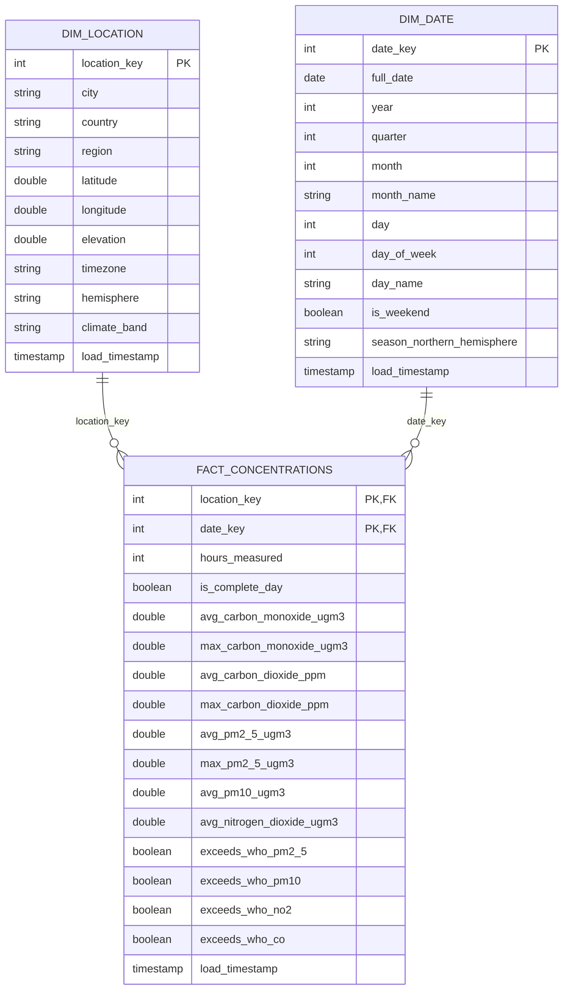

# Global Atmospheric Carbon Monitoring Lakehouse

An automated Medallion Architecture (Bronze, Silver, Gold) pipeline built with PySpark on Databricks. It ingests hourly air-quality **concentrations** for 100 global cities from a public API, cleans them into a typed Silver table, models them as a Gold star schema, and serves a Power BI dashboard.

**Team:** Muhammad Hamid Abad (24L-2534), Abdullah Zia (24L-2507)

---

## 1. Data source

| | |
|---|---|
| **Provider** | [Open-Meteo Air Quality API](https://open-meteo.com/en/docs/air-quality-api) (no API key) |
| **Endpoint** | `https://air-quality-api.open-meteo.com/v1/air-quality` |
| **Variables** | `carbon_monoxide` (µg/m³), `carbon_dioxide` (ppm), `pm2_5`, `pm10`, `nitrogen_dioxide` (µg/m³) |
| **Grain** | One API response per city, holding parallel hourly arrays |

- **Full load:** 3 years of hourly history for 100 cities, fetched in yearly chunks (`scripts/fetch_full_load.py`).
- **Incremental load:** one file per day (`incremental_YYYY-MM-DD.json`) holding all 100 cities (`scripts/fetch_incremental_load.py`). Recent values are forecast-model output that later runs can revise, so a window of several days can be re-fetched. The Silver and Gold `MERGE` then updates only the values that changed.
- **Concentrations, not emissions:** the API reports how much is in the air, not how much was released.
- The data holds **no PII** (model-grid coordinates and pollutant values only).

## 2. Repository structure

```
.
├── README.md
├── docs/
│   ├── Phase1_Project_Proposal.docx
│   ├── Phase3_Final_Report.pdf        # architecture, decision log, Spark analysis, FinOps
│   ├── GOLD_MODEL.md                  # Gold data dictionary and ER diagram
├── sample_data/                       # small real samples (full and incremental)
├── scripts/
│   ├── fetch_full_load.py             # 3-year history, 100 cities
│   └── fetch_incremental_load.py      # N daily files (one per day) into staging/new
└── notebooks/
    ├── 00_Config_and_Logging.ipynb    # paths, staging layout, audit log, settings validation (shared via %run)
    ├── 01_Raw_to_Bronze.ipynb         # raw JSON to Bronze, schema-drift quarantine, drift demo
    ├── 02_Bronze_to_Silver.ipynb      # Bronze to Silver: MERGE, validation, watermark, proof cells
    ├── 03_Silver_to_Gold.ipynb        # Silver to Gold star schema, clustering, audit copies
    └── 04_Run_Pipeline.ipynb          # runs 01, 02 and 03 in order and stops on a failure
```

## 3. Storage layout (Databricks Unity Catalog)

```
/Volumes/workspace/default/
├── staging/
│   ├── new/                       # fetched files NOT yet loaded into Bronze
│   ├── processed/                 # files already loaded (moved here after success)
│   └── pipeline_execution_logs    # one audit table for every layer
├── bronze_layer/
│   ├── bronze_carbon_data         # Bronze Delta table
│   └── bronze_quarantine          # rows that broke the schema
└── silver_layer/
    ├── silver_air_quality_readings
    ├── silver_quarantine          # rows that failed validation
    └── silver_watermark           # how far Silver has processed Bronze

workspace.gold  (Unity Catalog tables, read by the SQL warehouse and Power BI)
    dim_location, dim_date, fact_concentrations, gold_watermark
    audit_pipeline_execution_logs, audit_bronze_quarantine, audit_silver_quarantine
```

Bronze and Silver are Delta files in volumes. **Gold and the audit copies are catalog tables on purpose:** BI tools can only read catalog tables through a SQL warehouse.

## 4. Data models

### 4.1 Bronze: `bronze_carbon_data`
Append-only; **one row per city per source file**, kept in the API's nested shape. Written with an explicit `StructType` schema (no `inferSchema`).
**Primary key:** none enforced (append-only audit log). Logical identity is `(city, source_file, load_timestamp)`. Duplicates are removed in Silver.

| Column | Type | Description |
|---|---|---|
| latitude, longitude | DOUBLE | Model grid-cell coordinates |
| generationtime_ms | DOUBLE | API processing time |
| utc_offset_seconds | INT | Offset of the local timezone |
| timezone, timezone_abbreviation | STRING | Local timezone |
| elevation | DOUBLE | Metres |
| hourly_units | STRUCT | Units per variable (all STRING) |
| hourly | STRUCT | Parallel arrays: `time` ARRAY<STRING>; `carbon_monoxide`, `carbon_dioxide`, `pm2_5`, `pm10`, `nitrogen_dioxide` ARRAY<DOUBLE> |
| city | STRING | City name added at fetch time |
| source_system | STRING | `open-meteo-air-quality-api` |
| **source_file** | STRING | Path the file was read from (the file is then moved to `staging/processed`) |
| **load_timestamp** | TIMESTAMP | When the row was loaded into Bronze (identical for every row of a file) |

### 4.2 Bronze quarantine: `bronze_quarantine`
Rows with a column the schema does not know or a value of the wrong type.

| Column | Type | Description |
|---|---|---|
| city | STRING | |
| source_file | STRING | Origin file |
| rescued_data | STRING | JSON of the fields that did not fit the schema |
| quarantine_reason | STRING | `SCHEMA_DRIFT: unexpected column or data-type mismatch` |
| load_timestamp | TIMESTAMP | When it was quarantined |

### 4.3 Silver: `silver_air_quality_readings`
**One row per city per hour.** **Primary key: `(city, reading_time)`.**

| Column | Type | Nullable | Description |
|---|---|---|---|
| **city** | STRING | No | PK |
| **reading_time** | TIMESTAMP | No | PK; exploded from `hourly.time` |
| latitude, longitude, elevation | DOUBLE | Yes | From the payload |
| timezone | STRING | Yes | |
| carbon_monoxide_ugm3 | DOUBLE | Yes | µg/m³ |
| carbon_dioxide_ppm | DOUBLE | Yes | ppm |
| pm2_5_ugm3, pm10_ugm3, nitrogen_dioxide_ugm3 | DOUBLE | Yes | µg/m³ |
| source_file | STRING | Yes | Lineage back to the raw file |
| bronze_load_timestamp | TIMESTAMP | Yes | `load_timestamp` of the Bronze row used |
| **load_timestamp** | TIMESTAMP | No | When this row was written or last changed in Silver |

### 4.4 Silver quarantine: `silver_quarantine`
Same columns as Silver (all nullable) plus `quarantine_reason` (`INVALID_TIMESTAMP`, `NULL_CITY`, `SENTINEL_VALUE_-999`, `NEGATIVE_OR_ZERO_VALUE`) and `load_timestamp`. Logical key: `(city, reading_time, quarantine_reason)`.

### 4.5 Gold: star schema
The fact table is **not** a copy of Silver: hourly readings are aggregated to **one row per city per day**.



| Table | Grain | Primary key | Foreign keys |
|---|---|---|---|
| `dim_location` | one row per city | `location_key` | none |
| `dim_date` | one row per calendar date | `date_key` (yyyymmdd) | none |
| `fact_concentrations` | one row per city per day | (`location_key`, `date_key`) | `location_key` to `dim_location`, `date_key` to `dim_date` |

- `location_key` is a deterministic hash of the city name, so the dimension and the fact compute the same value without a lookup join.
- `region` and `country` come from a reference list of the 100 cities; `hemisphere` and `climate_band` are derived from latitude.
- `is_complete_day` is true when a day has at least 23 hourly readings. Filter on it when averaging, because the latest day can be partial.
- `exceeds_who_*` marks a daily mean above the **WHO 2021 24-hour guideline**: PM2.5 15, PM10 45, NO₂ 25, CO 4,000 µg/m³. The WHO sets no CO₂ guideline, so CO₂ is analysed as a trend only.
- The primary and foreign keys are informational Unity Catalog constraints; Power BI uses them to detect the relationships.

### 4.6 Operational tables

**`pipeline_execution_logs`**: one row per file (Raw-to-Bronze), per run or chunk (Bronze-to-Silver), and per table (Silver-to-Gold).

| Column | Type | Description |
|---|---|---|
| layer_processed | STRING | `Raw-to-Bronze`, `Bronze-to-Silver` or `Silver-to-Gold` |
| parameter_processed | STRING | File path, date window or timestamp range (Gold also records Silver rows aggregated into city-days) |
| load_type | STRING | `full`, `incremental` or `backfill` (plus test labels) |
| start_time, end_time | TIMESTAMP | Run start and end |
| status | STRING | `Success`, `Partial Success` (some rows quarantined, the rest loaded) or `Failure` |
| rows_inserted, rows_updated | INT | Bronze: inserted = rows loaded. Silver and Gold: from the MERGE metrics |
| rows_quarantined | INT | Rows sent to a quarantine table |
| error_message | STRING | Error text, or the quarantine explanation |

**`silver_watermark`** and **`gold_watermark`**: the newest upstream `load_timestamp` already processed (`processed_up_to`, `updated_at`).

## 5. How the pipeline works

- **Schema-on-read:** Bronze reads with explicit `StructType`/`StructField` definitions, never `inferSchema`. Silver casts every field to its final type.
- **Idempotency:** Silver and Gold use `MERGE INTO`. New rows are inserted; matched rows are updated **only if a value differs**. Running the same input twice changes nothing, not even `load_timestamp`.
- **Duplicates:** overlapping Bronze loads can repeat an hour; Silver keeps the most recently ingested row, so a revised forecast value wins.
- **Schema drift:** Bronze reads with `rescuedDataColumn`. A new column or a changed type does not crash the batch: conforming rows go to Bronze, the others to `bronze_quarantine`, and the log shows `Partial Success`.
- **Bad records in Silver:** invalid timestamps, `-999` sentinels and negative or zero values go to `silver_quarantine` with a reason; valid rows of the same batch still load.
- **Incremental runs:** Silver keeps the newest Bronze load it processed, Gold keeps the newest Silver change it processed. A normal run needs no dates.
- **Gold refresh:** Silver rows that changed identify the affected city-days; those days are re-aggregated in full and merged. Aggregates are rounded to four decimals so identical data gives identical values.
- **Read optimisation:** the fact table uses **Liquid Clustering** on (`location_key`, `date_key`), and `OPTIMIZE` runs after each refresh that changed rows. Silver and Gold are not partitioned: at about 2.6 million and 111,000 rows, partitions would create many tiny files.
- **Backfill:** every notebook accepts a date range and can replay any past period without code changes.
- **Audit:** every run, success or failure, writes to `pipeline_execution_logs`. Copies of the log and both quarantine tables are published into `workspace.gold` for the dashboard.

## 6. Run guide

**One-time setup:** import the five notebooks into the same workspace folder and run `00_Config_and_Logging` (creates volumes, folders and the log table).

Each notebook has a **SETTINGS cell** (plain variables with the allowed options listed). Edit the values, then run the next cell. The values are validated first: a bad mode, a date that is not `YYYY-MM-DD`, a start after the end, or a backfill without dates stops with a clear message before anything runs.

### Daily incremental load
1. Fetch: set `WINDOW_DAYS` (1 = yesterday, 5 = five daily files) in `fetch_incremental_load.py` and run it. Files land in `staging/new`.
2. Open `04_Run_Pipeline`, set `MODE = "incremental"`, and run the cells. Bronze, Silver and Gold run in order and the run stops if any layer logs a failure.

### Backfill an older period
| Purpose | Where | Settings |
|---|---|---|
| All layers for a period | `04_Run_Pipeline` | `MODE = "backfill"`, `START_DATE`, `END_DATE` |
| One day | any notebook | `MODE = "backfill"`, `START_DATE` only |
| Raw to Bronze for a period | `01` | `MODE = "backfill"`, `START_DATE`, `END_DATE` (searches `new` and `processed`) |
| Reload one exact file | `01` | `MODE = "backfill"`, `FILE_NAME = "full_load_last_3_years.json"` |
| Bronze to Silver for a period | `02` | `MODE = "backfill"`, dates, optional `CHUNK_DAYS` (default 90) |
| Silver to Gold for a period | `03` | `MODE = "backfill"`, `START_DATE`, `END_DATE` |

Re-running a backfill is safe: Bronze appends the raw rows again, and the Silver and Gold merges leave identical data untouched.

## 7. Verified results (from `pipeline_execution_logs`)

| Scenario | Result |
|---|---|
| Full load into Bronze | 100 rows (1 per city), status Success |
| 9 daily incremental files | 100 rows each, status Success |
| First Silver run | 2,647,200 rows inserted (100 cities × 26,472 hours), 0 updated, 0 quarantined |
| Same Silver window run twice | 0 inserted, 0 updated both times |
| One value changed in Silver, window re-run | 0 inserted, **1 updated**, value restored |
| Six new days through all three layers | Silver 14,400 rows inserted; Gold 600 fact rows and 6 date rows inserted (14,400 Silver rows aggregated into 600 city-days) |
| Run with nothing new | Bronze-to-Silver and Silver-to-Gold both log 0 inserted, 0 updated |
| Schema-drift test (1 valid, 1 new column, 1 changed type) | 1 row to Bronze, 2 to `bronze_quarantine`, status Partial Success |

Executed notebooks with their outputs are in `docs/outputs/`. The proof cells are at the end of `01` (drift demo), `02` (re-run and revised-value proof) and `03` (Gold re-run proof).

## 8. Dashboard (Power BI)

Power BI Desktop connects to a Databricks SQL warehouse and imports the Gold tables and the three audit tables. The model mirrors the star schema (one-to-many from each dimension to the fact table, `dim_date` marked as the date table).

| Page | Answers | Main visuals |
|---|---|---|
| **Air Quality** | Which regions change most year over year? How do concentrations vary by month and season? How often do cities exceed WHO guidelines? | KPI cards (average PM2.5, average CO₂, peak PM2.5, share of days above the WHO PM2.5 guideline), city map, monthly line chart by region, region and year columns (2024 vs 2025), month by region heat matrix, days above the WHO guideline by city, CO₂ by month |
| **Pipeline Audit** | Is the pipeline healthy? | Runs by layer and status, average duration by layer, rows loaded per layer, quarantine count, problem-run table, `load_type` slicer |

The year-over-year chart uses 2024 and 2025 only, because 2023 (from October) and 2026 (to October) are partial years. CO₂ charts start in late 2024, when the source begins to report CO₂.

## 9. Security and compliance
The payload holds only model-grid coordinates, elevation, timezone and pollutant readings: no names, emails or device identifiers, so **no PII**. No credentials are stored in the repository. The API needs no key, and the Databricks access token used by Power BI is kept outside the repo.

## 10. Infrastructure and cost
Databricks Free Edition (serverless compute, Unity Catalog volumes and tables). Serverless has no classic Spark UI, so the Query Profile and `explain()` are used for execution analysis. Measured run times (a daily incremental run takes about a minute across all three layers) and a list-price estimate for an hourly enterprise deployment are in `docs/Phase3_Final_Report.pdf`.
