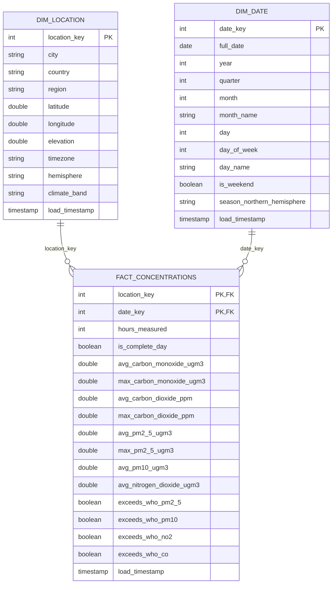

# Gold layer: star schema

Gold tables are Unity Catalog tables in `workspace.gold`, so Power BI / Tableau can query them through a SQL warehouse. The fact table is **not** a copy of Silver: hourly readings are aggregated to **one row per city per day**.

## Tables

| Table | Grain | Primary key | Foreign keys |
|---|---|---|---|
| `dim_location` | one row per city | `location_key` | none |
| `dim_date` | one row per calendar date | `date_key` (yyyymmdd) | none |
| `fact_concentrations` | one row per city per day | (`location_key`, `date_key`) | `location_key` → `dim_location`, `date_key` → `dim_date` |

Both relationships are one-to-many (one dimension row, many fact rows). The PK/FK constraints are informational (Unity Catalog does not enforce them); they let BI tools detect the relationships.

**`location_key`** is a deterministic hash of the city name, so the dimension and the fact compute the same value without a lookup join.

## Key columns

- `region`, `country`: from a reference list of the 100 cities (used for the regional breakdown).
- `hemisphere`, `climate_band`: derived from latitude (Tropical < 23.5°, Subtropical < 35°, Temperate < 55°, otherwise Subpolar).
- `season_northern_hemisphere`: meteorological season by month. Southern-hemisphere cities have the opposite season, so use `month` for cross-hemisphere comparison.
- `hours_measured` / `is_complete_day`: a day with at least 23 hourly readings. Filter on `is_complete_day` for averages (the latest day can be partial).
- `exceeds_who_*`: the daily mean is above the WHO 2021 24-hour guideline value (PM2.5 15, PM10 45, NO2 25, CO 4,000 µg/m³). The WHO sets no CO2 guideline, so CO2 is analysed as a concentration trend only.
- Concentration columns are **concentrations** (ppm or µg/m³), not emissions.

## Refresh and optimisation

- **Incremental:** Gold takes the Silver rows whose `load_timestamp` is newer than its watermark (`gold_watermark`), finds the affected city-days, re-aggregates those full days from Silver and `MERGE`s them. Only rows whose values differ are updated, so a re-run changes nothing.
- **Backfill:** `mode = backfill` with a date range re-aggregates every city-day in the range.
- **Read optimisation:** `fact_concentrations` uses **Liquid Clustering** on (`location_key`, `date_key`) and `OPTIMIZE` runs after each refresh that changed rows. `DESCRIBE DETAIL` shows the clustering columns and file layout.
- **Audit tables for BI:** `audit_pipeline_execution_logs`, `audit_bronze_quarantine` and `audit_silver_quarantine` are copied into `workspace.gold` after each run so the dashboard can chart run status, durations and quarantined rows.
- **Logging:** each Gold run writes one `Silver-to-Gold` row per table to `pipeline_execution_logs` (rows inserted/updated, start/end time). The row text also records how many Silver rows were aggregated into how many city-days.
